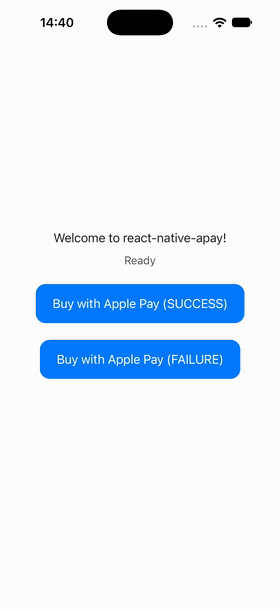

# react-native-apay

[](https://github.com/facebook/react-native/releases/tag/v0.76.0)

[](https://github.com/sorokin0andrey/react-native-apay)

Accept payments with Apple Pay in React Native apps. The iOS implementation is a [Turbo Module](https://reactnative.dev/docs/the-new-architecture/pillars-turbomodules) written in Swift, with a thin Objective-C++ registration layer that React Native Codegen requires.

<div>
<a href="preview.mp4">

</a>
</div>

## Requirements

- React Native `>= 0.76` with the New Architecture enabled. React Native 0.82 and newer are New Architecture only.
- iOS deployment target supported by your React Native version (15.1+ for React Native 0.88).
- An Apple Pay merchant identifier and the Apple Pay capability on the app target.

Apple Pay is iOS-only. On other platforms `requestPayment` and `complete` throw.

## Installation

```sh
npm install react-native-apay
cd ios && pod install
```

Autolinking picks up the iOS pod. Android is intentionally not linked.

In Xcode, enable the Apple Pay capability and add your merchant identifier to the app entitlements.

## Usage

```javascript
import { ApplePay } from 'react-native-apay';

const requestData = {
  merchantIdentifier: 'merchant.com.example',
  supportedNetworks: ['masterCard', 'visa'],
  countryCode: 'US',
  currencyCode: 'USD',
  paymentSummaryItems: [
    {
      label: 'Item label',
      amount: '100.00',
    },
  ],
};

if (ApplePay.canMakePayments) {
  ApplePay.requestPayment(requestData).then(paymentData => {
    if (paymentData == null) {
      // The payer dismissed the sheet before authorizing.
      return;
    }

    console.log(paymentData);

    // Send paymentData to your payment processor, then settle the sheet.
    ApplePay.complete(ApplePay.SUCCESS).then(() => {
      console.log('completed');
    });
  });
}
```

`requestPayment` resolves with the payment token JSON, or with `null` when the payer cancels. Call `complete` with `ApplePay.SUCCESS` or `ApplePay.FAILURE` after authorization so the sheet can finish.

`paymentSummaryItems[].amount` is a decimal string such as `'100.00'`. Set `pending: true` for a summary item whose amount is not final yet.

### Supported networks

`amex`, `masterCard`, `visa`, `privateLabel`, `discover`, `chinaUnionPay`, `interac`, `jcb`, `suica`, `carteBancaires`, `idcredit`, `quicpay`, `cartesBancaires`, `maestro`, `eftpos`, `electron`, `vPay`, `elo`, `girocard`, `mada`, `mir`.

`mastercard`, `privatelabel`, and `cartebancaires` are accepted as aliases.

## Example

The `Example` app is a React Native 0.88 project:

```sh
npm install
npm --prefix Example install
npm --prefix Example run ios
```

Replace the merchant identifier in `Example/App.tsx` and `Example/ios/Example/Example.entitlements` with your own before requesting a payment.
